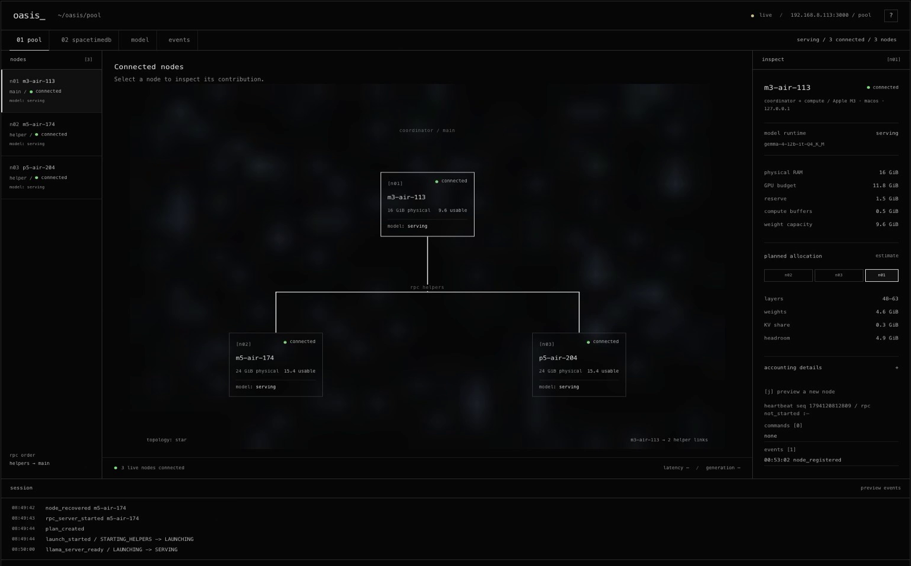
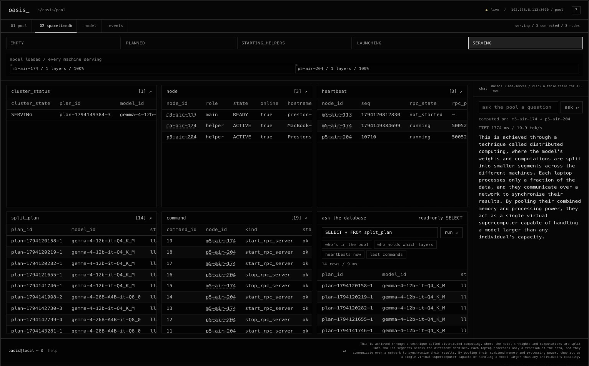

# Oasis

[](LICENSE)


**Oasis distributes large language model inference across the idle computers an office already owns.** It pools
their GPU memory over a private, offline network built from about $140 of parts, so that the machines together can
run a model none of them could hold alone. Documents never leave the building, and no new server is needed.

On three MacBook Airs, Oasis serves Gemma 4 26B, a 25.0 GiB model, at 12.5 tokens per second with 0.6 s to the first
token. The largest of the three laptops can give a model 17.8 GiB of GPU memory, so the model is 1.4 times larger than
any single machine in the pool.

[The problem](#the-problem) · [Approach](#approach) · [How it works](#how-oasis-works) · [Results](#results) ·
[Run it](#run-it) · [Related work](#related-work) · Built at HackUTD 2026 (Nov 7-8)



## The problem

Organizations that handle confidential records face a practical barrier to adopting large language models. Clinics,
law firms and accounting practices hold documents that privacy regulation, professional duty or client contracts
require them to keep on site. Hosted AI services work only if those documents are sent to a third party, which such
organizations often cannot do.

Running a model on site avoids that exposure but shifts the burden to hardware. A model's weights must fit in GPU
memory, and the models that answer reliably are large: Gemma 4 26B at 8-bit precision occupies 25.0 GiB. A server
with that much GPU memory costs several thousand dollars, a cost that is hard to justify for a practice of a few
people.

The memory such an office needs often exists already, but it is fragmented. A typical office owns several laptops
and desktops, each with a capable GPU that sits idle for most of the day. In the Oasis test pool, the largest machine
offers 17.8 GiB of GPU memory and the smallest 11.8 GiB. Neither can hold the 26B model, yet the three machines
together offer 47 GiB.

Oasis asks whether that fragmented memory can serve as one model server. Two conditions must hold. The pool must run
a model larger than any of its members at a usable speed, and it must operate as a single system that plans,
launches and recovers without an engineer at a terminal.

## Approach

Oasis treats a group of ordinary computers as one inference server and separates the work into two planes. The data
plane, llama.cpp's RPC backend, splits the model by layers across the machines' GPUs, so that each token passes
through every machine in turn. The control plane, built for this project, decides which machines take part, what
each one runs and what state the pool is in.

The control plane keeps all of its state in a SpacetimeDB database. Every machine, heartbeat, order, split plan and
state change is a row, and only the database's own functions can change those rows. A Rust agent on each machine and
a Rust coordinator on the main machine read and write the pool through that database and never through one another.

The project contributes:

- **A pooled inference server on hardware an office already owns.** Three MacBook Airs run Gemma 4 26B, 1.4 times
  larger than the largest of them, at 12.5 tokens per second, with no internet connection.
- **A control plane held in a database.** Registration, heartbeats, orders, split plans and the pool's state machine
  live in SpacetimeDB tables, and the database rejects any state change outside the allowed graph.
- **Operation without manual steps.** The pool plans and launches a model, switches models, admits a new machine
  while it keeps answering, and recovers from a lost machine on its own.
- **An offline network kit.** A travel router and a gigabit switch, with no internet uplink, give the pool a
  0.4-0.9 ms round trip between machines.
- **Measurements on real hardware**, with the raw files for every run in [test-runs/](test-runs/).

## How Oasis works

The system has three layers, from the network up:

| Layer | What it does | Built with |
|---|---|---|
| Network | A private wired LAN with no internet uplink. 0.4-0.9 ms round trip between machines. | GL.iNet Opal travel router, 5-port gigabit switch, USB-C Ethernet adapters (about $140) |
| Engine (data plane) | Splits the model by layers across the machines' GPUs and passes activations between them for every token. | llama.cpp b8665 over RPC |
| Control plane | Holds the pool's state, gives orders to each machine and plans the split. | SpacetimeDB 2.14.1 module, Rust agents and a Rust coordinator |

```
            browser: web/oasis.html     (reads SpacetimeDB :3000 and llama-server :8080)
                                  |
 main Mac  +----------------------+-----------------------+
           | SpacetimeDB :3000  <-- coordinator --> llama-server :8080
           +--------^------------------------------------|-------------+
                    | reducers + subscriptions           | llama.cpp RPC
 helper Macs  agent -> rpc-server :50052   agent -> rpc-server :50052
```

### 1. Machines join the pool

Each machine runs a small Rust program, the agent. On start, the agent reads its GPU devices and free memory
(`llama-server --list-devices`), registers itself as a row in the `node` table, and then sends a heartbeat every
second. When an agent disconnects, the database marks its machine offline at once. The agent also owns the
machine's `rpc-server`, the llama.cpp process that holds that machine's share of the model, and starts or stops it
only when the database tells it to.

### 2. The coordinator plans the split and launches the model

The coordinator runs on the main machine. Once enough helpers are online (`min_helpers`), it writes a split plan,
sends each helper a `command` row to start `rpc-server`, waits for each helper to report that it is listening, and
then launches `llama-server` with one `--rpc` address per helper. llama.cpp places the layers according to each
device's free memory; `tensor_split` in the config sets the layer counts by hand. On the 26B run, the M3 held
5718 MiB and each M5 held 9941 MiB, with all 31 layers on GPU.

From then on, `llama-server` on the main machine serves an OpenAI-style chat API at `:8080`. A client sends a
question to that one address and never needs to know how many machines answer it.

### 3. The pool's state lives in SpacetimeDB

SpacetimeDB is a database that runs application logic inside itself. Oasis uses it as the control plane: a module
written in Rust and compiled to WebAssembly (`crates/control`) defines the tables and the functions, called
reducers, that are allowed to change them. The agents and the coordinator change state only by calling reducers,
and they see every change through live subscriptions. No separate server or status API exists.

| Table | What a row holds |
|---|---|
| `node` | One machine: its id, role, GPU memory, address and whether it is online |
| `heartbeat` | The latest heartbeat from each machine, with a sequence number that rises every second |
| `command` | An order to one machine (start or stop `rpc-server`, probe), which the agent claims and completes |
| `split_plan` | Which machine holds which layers for the current model |
| `cluster_status` | The pool's state and the model it serves |
| `event` | The pool's history: plans, launches, joins, failures and recoveries |
| `model_request` | A request to switch the pool to another model |

A private `admin` table lists the identities allowed to give orders. The pool's state is a state machine that the
database itself enforces: `EMPTY → PLANNED → STARTING_HELPERS → LAUNCHING → SERVING`, with `DEGRADED`,
`RECOVERING`, `FAILED` and `STOPPED` for failures and shutdown. A reducer rejects any transition outside that
graph, so no program can put the pool into an impossible state.



Rust runs on both sides of the database. The generated client bindings sit in `crates/contracts`, so a change to
the schema that an agent or the coordinator does not match fails at compile time instead of at run time.

### 4. The pool changes while it runs

- **Model switch.** A call to the `request_model` reducer (from the dashboard or one `curl`) asks for another
  model. The coordinator re-plans and reloads, and the dashboard shows `PLANNED`, `STARTING_HELPERS`, `LAUNCHING`
  and `SERVING` as they happen. The coordinator only loads models listed under `[models]` in its config.
- **Live join.** A new machine registers and starts `rpc-server`. The pool keeps answering in the meantime, then
  re-splits the model across all machines in one reload (18 s on the 12B).
- **Recovery.** llama.cpp stops when a helper disappears, so the request in progress fails. The coordinator detects
  the lost helper, moves the pool to `DEGRADED`, re-plans onto the machines that remain and answers again about
  30 s later (12B).

### 5. The dashboard shows all of it

The dashboard is one HTML file (`web/oasis.html`) that reads SpacetimeDB and `llama-server` directly. It shows the
machines and their states, the event history, the share of the model each machine holds, and a command line.
Typing `ask <question>` streams an answer from the pool with its time to first token and tokens per second. The
dashboard only reads; it never calls a reducer. The screenshots on this page show `web/oasis-v4.html`, the version
in the demo video, which adds a `02 spacetimedb` view with the live tables and a read-only SQL box.

## Results

Generation speed of Gemma 4 on three pooled MacBook Airs and on one Air alone, measured Sun Nov 8 2026:

| Run | Model | Machines | Flags | Gen tok/s (median) | TTFT | Raw files |
|---|---|---|---|---|---|---|
| **B3** | **Gemma 4 26B-A4B Q8_0 (25.0 GiB)** | **3 Airs** | FA, q8 KV, `--no-mmap` | **12.5** (12.1-12.6), flat for 5 min | **0.6 s** (short/long) | `test-runs/bench/p4-26b-final/` |
| B2-fa | Gemma 4 12B Q4_K_M (7.1 GB) | 3 Airs | FA, q8 KV | 11.2 (10.8-11.9), flat for 5.5 min | 0.6-0.7 s | `test-runs/bench/p4-20261108-0150-existing-fa-q8/` |
| B1 | Gemma 4 12B Q4_K_M | 1 M5 Air | none | ~16 cold, **8-9 sustained** (throttles after ~1.5 min) | 0.3-0.9 s | `test-runs/bench/night-20261108-0408/` |
| B1s | Gemma 4 12B Q4_K_M | 1 M5 Air | `--spec-type ngram-simple` | rewrite task: **1.6-1.7x** (9 → 14.5, 7.2 → 12.4); new text: no gain | | `test-runs/bench/night-20261108-0329/`, `-0408/` |

<details>
<summary>? What this table shows</summary>

- **Hardware:** three MacBook Airs on a gigabit switch (M3 16 GB as main, two M5 24 GB as helpers), llama.cpp
  b8665 over RPC, SpacetimeDB as the control plane, no internet.
- **Method:** every number comes from `bench` with thinking off and a 4096-token context. Each prompt gets one
  warm-up and 3 measured runs (short 128, long 512, edit 512 tokens). Values are medians.
- **Gen tok/s:** generated tokens per second.
- **TTFT:** time to first token.
- **FA, q8 KV:** flash attention and an 8-bit KV cache.
- **`--no-mmap`:** main reads only its share of the weights into memory instead of mapping the whole file.
- **`--spec-type ngram-simple`:** speculative decoding that drafts tokens from text already in the context, with
  no draft model.

Findings:

- The 26B runs on hardware where no single machine can hold it. Its weights are 25.0 GiB, 1.4x the largest Air's
  GPU budget of 17.8 GiB. 9 of 9 requests succeeded.
- Sustained, the pool is faster than one laptop. Three fanless Airs hold 11-12.5 tok/s for minutes, while one Air
  alone drops from ~16 to 8-9 tok/s as it heats up. Cold, one Air is faster on the 12B. The pool runs used flash
  attention and q8 KV; B1 did not.
- N-gram speculative decoding speeds up rewrite tasks 1.6-1.7x (79% draft acceptance) and gives no gain on new text.
- Gemma 4 26B is a mixture-of-experts model: it reads about 4B of its 26B parameters per token, which suits a pool
  where every token crosses the network.

Every run on the hardware is listed in [test-runs/INDEX.md](test-runs/INDEX.md).

</details>

## Run it

**Needs:** two or more Macs on one private wired network, llama.cpp build 8665 binaries on each Mac, a GGUF model
on the main Mac, and Rust (`rust-toolchain.toml` pins 1.99.1 and the wasm32 target; rustup installs both on the
first `cargo` command). The pool uses ports 3000 (SpacetimeDB), 8080 (`llama-server`) and 50052 (`rpc-server`).
[docs/network.md](docs/network.md) covers wiring, firewalls and the `netcheck` preflight.

Start every program below from Terminal.app or over SSH. macOS Local Network privacy blocks LAN connections from
command-line tools launched by another app (errno 65, Apple TN3179).

1. **Build**, on every Mac. No `protoc` is needed.

   ```
   git clone https://github.com/aayoawoyemi/hacktud_team_win.git
   cd hacktud_team_win
   cargo build --release
   ```

2. **Control plane**, on main. Install the `spacetime` CLI and pin it to 2.14.1, then start the server and publish
   the module as the database `pool`. Always pass `-s local`: the CLI's default server is the hosted maincloud.

   ```
   curl -sSf https://install.spacetimedb.com | sh
   spacetime version install 2.14.1 --use
   spacetime start
   spacetime publish -s local -p crates/control pool -y
   ```

3. **Agent**, on each helper. Copy `crates/agent/agent.example.toml` to `agent.toml` and set `node_id` (unique per
   machine), `role = "helper"`, `spacetime_uri = "http://<main-ip>:3000"` and `llama_bin_dir`. Keep the Mac awake
   and plugged in.

   ```
   caffeinate -dims &
   ./target/release/agent agent.toml
   ```

4. **Coordinator**, on main. Copy `crates/coordinator/coordinator.example.toml` to `coordinator.toml` and set
   `llama_server_path`, `model_path`, `model_id` and `min_helpers`. For a model bigger than main's memory, add
   `extra_args = ["--no-mmap"]`. `SPACETIME_TOKEN` is the publisher's token from `~/.config/spacetime/cli.toml`.
   The first run prints an `add_admin` command; run it once. Press Enter to stop the pool.

   ```
   SPACETIME_TOKEN=<publisher token> ./target/release/coordinator coordinator.toml
   ```

   The pool is ready when the coordinator prints `SERVING on 8080` (about 35 s for the 12B with warm caches).

5. **Dashboard**, from any machine that reaches main:

   ```
   cd web && python3 -m http.server 8000
   ```

   Then open `http://<this-machine>:8000/oasis.html?stdb=http://<main-ip>:3000&llama=http://<main-ip>:8080`.
   `oasis-v4.html` and `oasis-v2.html` take the same parameters; v4 adds the SpacetimeDB view and v2 adds a model
   menu and a chat. `oasis.html?demo=1` plays sample data without a pool.

6. **Chat.** `llama-server` on main serves the OpenAI-style API:

   ```
   curl http://<main-ip>:8080/v1/chat/completions -H 'Content-Type: application/json' \
     -d '{"messages":[{"role":"user","content":"Hello"}],"max_tokens":512}'
   ```

7. **Switch models.** Any model listed under `[models]` in `coordinator.toml`:

   ```
   curl -X POST http://<main-ip>:3000/v1/database/pool/call/request_model \
     -H 'Content-Type: application/json' -d '["gemma-4-26B-A4B-it-Q8_0"]'
   ```

<details>
<summary>? Benchmarks and other commands</summary>

- **Bench:** copy `crates/bench/bench.example.toml` to `bench.toml`, set `scenario`, `model_id` and `nodes` to
  match the launch, then run `cargo run -p bench --release -- bench.toml`.
- **Night bench** (B1 to B5 in a row on main): copy `scripts/bench-night.env.example` to `scripts/bench-night.env`,
  fill in the paths, then run `open -a Terminal scripts/bench-night.command`. Results land in
  `test-runs/bench/night-<stamp>/SUMMARY.md`.
- **Tests:** `cargo test` from the repo root runs the workspace's 97 tests.
- **After changing `crates/control`,** regenerate the committed client bindings:
  `spacetime generate --lang rust --out-dir crates/contracts/src/control --module-path crates/control -y`.
- **The full demo**, from a cold start to a model switch and a live join, with a check after every step:
  [docs/demo-runbook.md](docs/demo-runbook.md).

</details>

## Known limits

- **Main must load big models with `--no-mmap`.** With mmap, the 26B mapped 25.6 GB on the 16 GB M3 and generation
  stalled in Metal (`IOGPUCommandDescriptor::prepare … 0xE00002BE`). With `--no-mmap`, main holds only its
  5718 MiB share.
- **A cold 26B load takes about 5 min** (303 s measured) while the weights stream to the helpers. `rpc-server -c`
  (`rpc_cache = true` in `agent.toml`) caches them for the next load.
- **A lost helper fails the request in progress.** llama.cpp aborts when an RPC peer disappears; the pool answers
  again about 30 s later on the remaining machines.
- **A sleeping helper takes the pool down** until it is back. Run `caffeinate -dims` on every helper and keep the
  Macs on power.
- **Use a wired network.** Every token crosses the network once per helper, so latency per hop sets the speed more
  than bandwidth does.
- **No encryption or authentication between machines.** llama.cpp RPC has neither, so the pool must stay on its own
  private network.
- **Thermals:** fanless MacBook Airs throttle after about 1.5 min of generation.
- **Gemma 4 writes its thinking to `reasoning_content`.** A low `max_tokens` (128) can return an empty answer.

## Repository layout

| Path | Contents |
|---|---|
| `crates/control` | The SpacetimeDB module: tables, reducers and the cluster state machine |
| `crates/contracts` | Shared types, llama.cpp output parsers and the generated SpacetimeDB client bindings |
| `crates/agent` | Per-machine agent: hardware probe, registration, heartbeats, `rpc-server` supervision |
| `crates/coordinator` | Main-Mac process: plans the split, launches `llama-server`, re-plans on joins, losses and model requests |
| `crates/bench` | Benchmark runner: time to first token and tokens/s, written as JSONL, CSV and markdown |
| `crates/netcheck` | Port reachability, round-trip time and throughput between machines |
| `crates/planner`, `crates/relay` | Placeholders for a fit-checking split planner and relay telemetry |
| `web/` | Dashboards: `oasis.html`, `oasis-v4.html` (adds the SpacetimeDB view) and `oasis-v2.html` (adds a model menu and chat) |
| `docs/` | [Network setup](docs/network.md), [demo runbook](docs/demo-runbook.md), [team workflow](docs/team-workflow.md) |
| `test-runs/` | Logs and numbers from every run on the hardware |
| `scripts/` | Team git commands and the night bench |
| `CONTRACTS.md` | Shared shapes: tables, reducers, routes, env vars, folder ownership |

Model files (`models/`, `*.gguf`) and `target/` are git-ignored.

## Related work

Pooling consumer devices for inference is an active area, and Oasis builds on parts of it.

| Project | What it does | How Oasis differs |
|---|---|---|
| [llama.cpp RPC](https://github.com/ggml-org/llama.cpp) | Splits a model by layers across `rpc-server` processes on other machines | Oasis uses it as the data plane and adds discovery, planning, supervision and recovery around it |
| [exo](https://github.com/exo-explore/exo) | Pools Apple devices into an AI cluster with MLX, automatic discovery and a dashboard | Oasis targets an offline kit for hardware an office already owns and keeps the pool's state in a database |
| [prima.cpp](https://arxiv.org/abs/2504.08791) | Runs 30-70B models on mixed home clusters with a layer scheduler | Oasis focuses on operating the pool (state, orders, recovery) and leaves layer math to llama.cpp |
| [distributed-llama](https://github.com/b4rtaz/distributed-llama) | Tensor parallelism over Ethernet across home devices | Oasis splits by layers and adds a control plane |
| [GPUStack](https://github.com/gpustack/gpustack), [LocalAI](https://github.com/mudler/LocalAI) | Cluster managers with distributed llama.cpp backends | Oasis holds its control state in SpacetimeDB tables and enforces the state machine in the database |

None of these projects is the first to pool home devices, and Oasis does not claim that. Its distinct parts are the
control plane held in SpacetimeDB and the offline kit sized for a small regulated office.

Team Oasis and its coding agents built the project at HackUTD 2026 (Nov 7-8). Each task ran in its own branch and
folder, and small pull requests merged into `main` many times an hour; the commands and agent rules are in
[docs/team-workflow.md](docs/team-workflow.md).

## License

MIT. See [LICENSE](LICENSE). llama.cpp and SpacetimeDB keep their own licenses.
